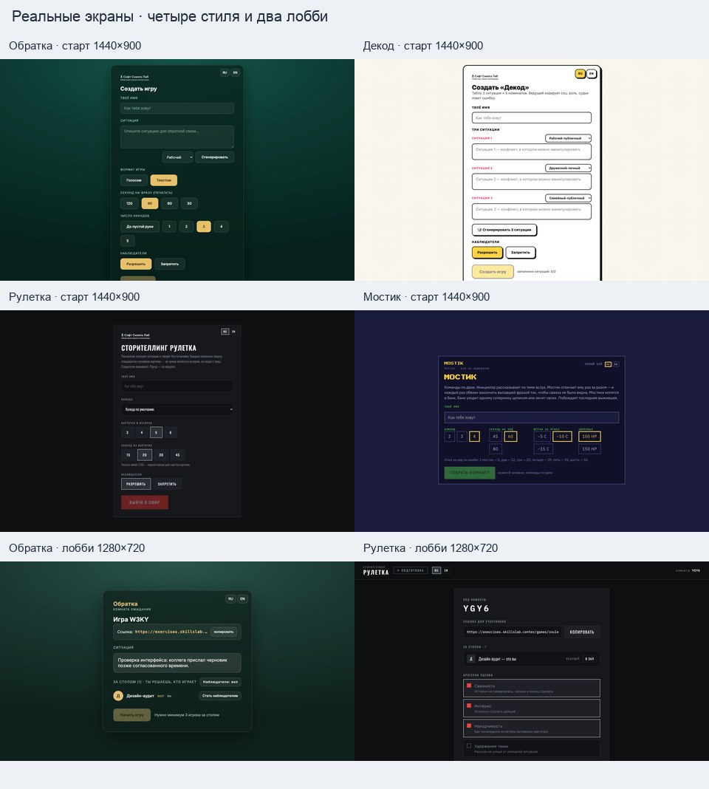
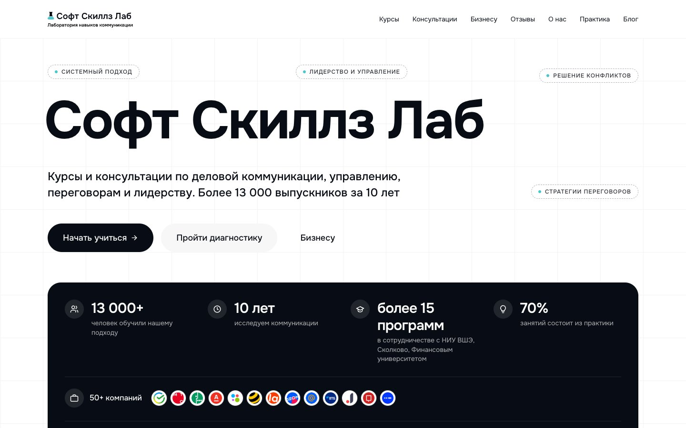

# Дизайн-аудит Soft Skills Lab · 13.10.2026

**Этап 1: исследование и дизайн-ТЗ, без frontend/backend.** Приоритет — [DEMO_48H.md](DEMO_48H.md); задание — [CODEX_DESIGN_AUDIT.md](../prompts/CODEX_DESIGN_AUDIT.md). Результирующее направление: **«Линия решения»**, самостоятельная игра «Конфликты и переговоры». Спецификация — [BRANDBOOK_DEMO.md](BRANDBOOK_DEMO.md).

Маркировка утверждений: **[Н]** — проверенное наблюдение; **[В]** — обоснованный вывод, ограниченный выборкой; **[П]** — наше оригинальное предложение. В таблицах колонка с маркировкой распространяется на всё содержимое соответствующей ячейки. Внешние скриншоты служат исследовательскими свидетельствами, а не ассетами будущего продукта.

## 1. Исходное состояние и доступ

**[Н]** Проверены все пять запрошенных документов: `DEMO_48H.md`, оба промпта, `UI.md`, `compact_runtime_spec.yaml`. Дополнительно прочитана публичная часть `case.schema.json`. Настоящий Git-репозиторий находится в подкаталоге `peregovori`; до работы изменений не было. Локальные HEAD и `origin/main`, а также live `git ls-remote origin HEAD refs/heads/main` совпали: `bec4688535104e8d6867e67b6c7b7fbb2bb7c4c0`. Датасеты, курс и модельные эксперименты не изменялись.

| [Н] Способ | Результат и границы |
|---|---|
| Обычный Codex In-app Browser | Главный сайт, каталог и пять стартов открылись с отрендеренным DOM. Начальные снимки и два лобби — фактически **1280×720**. |
| Прямой `curl`, все шесть proxy-переменных удалены, `--noproxy '*'` | В sandbox: `curl: (6) Could not resolve host`, HTTP 000 для обоих сайтов. После разрешённого выхода из sandbox тот же прямой запрос: **HTTP 200** для обоих HTML. Это ограничение терминального окружения, а не недоступность сайтов. |
| Публичные ресурсы из полученного HTML | CSS/JS каталога и основной CSS школы скачаны напрямую, HTTP 200, только в `/tmp/skillslab_design_audit`. HTML библиотеки — JS-оболочка, 486 байт; выводы сделаны по отрендеренной странице, не по оболочке. |
| Playwright Core + установленный Chrome, headless, `--no-proxy-server` | Отдельная временная среда, русская локаль; **1440×900 и 390×844**, HTTP 200 для главной, каталога и четырёх разных стартов. Размеры проверены через `innerWidth/innerHeight`, а не по запрошенной настройке. Домены авторизации и необязательные сторонние запросы исключены. |
| Размеры в In-app Browser | Вызов viewport override не изменил фактические 1280×720; отдельный Chrome использован для точных размеров. Повторное открытие через подключённый Chrome UI вернуло `Browser is not available: chrome`. Это не относится к установленному headless Chrome. Override сброшен. |
| Прокси / локальное зеркало | Не потребовались: прямой доступ работает. Прокси и учётные данные не придумывались. Отрендерены живые публичные страницы; локальное зеркало не создавалось. |

**[Н]** «Обратка — конструктор» сначала показала промежуточное состояние входа, затем направила на `https://id.skillslab.center`. Автоматическая проверка отклонила чтение этого отдельного домена авторизации: он не был разрешён как публичный источник и мог содержать приватную сессию. Вход не обходился; интерфейс конструктора неизвестен. Его название и ссылка подтверждены **только карточкой каталога**.

**[Н]** Создание двух тестовых комнат сначала было отклонено автоматической проверкой из-за записи состояния на чужом сервере. После отдельного явного разрешения пользователя созданы «Обратка» и «Сторителлинг рулетка» с именем «Дизайн-аудит» и вымышленной ситуацией. Увидены лобби; раунды не запущены: нужны соответственно ≥3 и ≥2 участника. У комнат не обнаружена кнопка удаления; срок хранения не проверен. Другие участники не приглашались, сообщения людям не отправлялись.

## 2. Проверенные страницы и игры

**[Н]** [Главная школа](https://skillslab.center/) — hero, навигация, текстовые блоки и структура страницы в DOM, desktop/mobile. [Каталог](https://exercises.skillslab.center/games) — шесть настоящих карточек; полный список без пересказанных описаний записан в [GAMES_LINKS_VERIFIED.json](GAMES_LINKS_VERIFIED.json). В JSON подтверждение карточки не означает проверку самой игры.

**[Н]** На главной — липкая светлая шапка с логотипом и навигацией; в DOM нижний тёмный footer с продуктовыми/практическими ссылками и формой подписки. Footer не снят отдельным кадром, формы не отправлялись. В каталоге и четырёх исследованных стартовых шаблонах отдельного footer нет; бренд/возврат и язык расположены сверху панели. В лобби «Рулетки» появляется горизонтальная шапка со статусом подготовки, в лобби «Обратки» основная информация остаётся в центральной панели.

| Игра / подтверждённая ссылка | [Н] Увиденные экраны | [Н] Свой стиль и механика на экране | [Н] Свидетельства / неизвестные |
|---|---|---|---|
| [Обратка](https://exercises.skillslab.center/games/obratka) | Старт D/M, заполнение, переход в лобби D | Зелёный градиент; тёмная мягкая панель, золото; Inter. Ситуация, категория, голос/текст, время, раунды, наблюдатели. В лобби — ситуация, участник, ссылка комнаты. | `obratka-{desktop,mobile-full}.jpg`, `obratka-room-iab.jpg`, классы `.ob-*`. Активный карточный раунд, чат и итог не увидены; запуск требует трёх игроков. |
| [Декод](https://exercises.skillslab.center/games/decode) | Старт D/M; имя, переключение наблюдателей | Светлая точечная бумага, белая панель; толстая чёрная обводка, жёсткая смещённая тень; жёлтый выбор, розовые подписи. Три ситуации; ввод типов и счётчик заполнения. | `decode-{desktop,mobile-full}.jpg`, `decode-state-iab.jpg`, `.dc-*`. После выбора запрета кнопка стала жёлтой; запуск остался disabled при 0/3 ситуаций. Табло и результат раунда не увидены. |
| [Сторителлинг рулетка](https://exercises.skillslab.center/games/roulette) | Старт D/M, заполнение, лобби D | Графит/чёрный, красная основная кнопка, прямоугольники без радиусов; Oswald, прописные заголовки, фоновые полосы. Колода, карточки/секунды, рассчитанная длительность. Лобби — критерии, ритм, участники. | `roulette-{desktop,mobile-full}.jpg`, `roulette-room-iab.jpg`, `.rt-*`. Эфир требует двух участников; рассказ, раскрытие карт, оценка не наблюдались. |
| [Мостик](https://exercises.skillslab.center/games/bridges) | Старт D/M | Индиго и почти чёрная панель; пиксельный заголовок, моно-подписи; зелёный CTA, жёлтый выбор. Настройки команд, секунд, штрафа и HP; объяснение комбо. | `bridges-{desktop,mobile-full}.jpg`, `.br-*`. Арена, HP в бою и динамика комбо не увидены. |
| [Мостик — дуэль](https://exercises.skillslab.center/games/bridges/duel) | Старт, DOM в In-app Browser | Та же аркадная тема, отдельное описание игры один на один; нет выбора числа команд. | Прямая страница и AX-дерево. Не считаем эту вариацию пятой независимой художественной концепцией; mobile отдельно не снимался. |
| [Обратка — конструктор](https://exercises.skillslab.center/games/feedback) | Карточка каталога; промежуточный вход | Внутренний стиль не исследован. | Ссылка обнаружена в реальном `<a>`; после перехода — отдельный домен авторизации. |

## 3. Shared DNA / Общее визуальное ДНК

**[Н]** Общие черты подтверждены на **четырёх разных стартах**, а не перенесены из одной игры:

- Возврат в каталог в верхней части; RU/EN рядом с игровым входом. У трёх игр возврат оформлен логотипом, у «Мостика» — словесным знаком своей игры. Единого оформления шапки нет.
- Отдельный вход в конкретную игру: компактная по ширине панель, настройки механики и одно основное действие запуска. Поле имени, значения по умолчанию и запрет запуска без обязательного ввода.
- Варианты параметров часто показаны группами кнопок; выбранный вариант видимо отличается. Категории/колоды — select; описания ситуации — textarea. У всех четырёх есть управление наблюдателями или числом участников; не все эти настройки обязательны нашему одиночному тренажёру.
- Понятные бытовые роли и прямые действия. Обращение к игроку на «ты»; «Рулетка» и «Мостик» дополнительно используют язык собственной игровой темы.
- На мобильной ширине сохраняется идентичность игры: панель сужается, группы переносятся/складываются, длинные настройки прокручиваются. По проверенным начальным экранам горизонтального overflow нет.

**[Н]** В двух проверенных лобби есть статус подготовки, участники с обозначением ведущего/хоста, ссылка для входа и ясная причина недоступности запуска. Это общий паттерн **двух лобби**, а не доказанная архитектура каждой игры.

**[В]** Семейство связывает общая точка входа, понятная учебная задача и интерфейс, построенный вокруг конкретной игровой механики. Индивидуальный мир внутри карточки допустим. Поэтому совместимость нашей игры лучше строить на ясном входе, коротком объяснении, видимых состояниях и завершённом цикле, чем на совпадении CSS-токенов.

**[В]** Самостоятельные оформление и названия создают ощущение игровых продуктов, а не каталога корпоративных инструментов. Степень завершённости активных раундов и общего accessibility-качества этим аудитом не доказана. Длинные формы и мелкие отдельные контролы — ограничения наблюдаемого входа, а не образцы для обязательного повторения.

## 4. Deliberate differences / Индивидуальность игр

| [Н] Параметр | Обратка | Декод | Рулетка | Мостик |
|---|---|---|---|---|
| Фон / материал | Зелёная глубина, полупрозрачная панель | Точечная бумага, белая карточка | Графит, полосы экрана | Плоское индиго, аркадная рамка |
| Главные цвета из CSS | `#15564B`, `#06211C`, `#E8C06A` | `#FAF6EE`, `#151515`, `#FFD23F` | `#0C0D0F`, `#16181C`, `#FF2D2D` | `#1B1B3E`, `#101028`, `#58D854`, `#FCD038` |
| Типографика | Inter, плавная и спокойная | system-ui, вес заголовка 900 | Oswald 300–500, узкая и эфирная | IBM Plex Sans + Mono, Press Start 2P в заголовке |
| Кнопки / поверхность | Радиус 11 px, тонкие линии | Радиус 11 px, контур 2.5 px, жёсткая тень | Радиус 0, контур 1 px | Прямоугольные рамки, игровая палитра |
| Выражение механики на старте | Ситуация и формат обратной связи | Три ситуации и счётчик 0/3 | Время истории из карточек и секунд | Время, HP, штраф, комбо |
| [В] Атмосфера | Камерная настольная | Энергичная печатная | Собранная, напряжённая эфирная | Аркадное состязание |

**[Н]** Большой иллюстрации-персонажа на этих четырёх стартах нет: тему несут шрифт, материал, контур, цвет и игровая терминология. **[В]** Для убедительного нового «тайтла» не нужен дорогой арт; достаточно последовательной системы этих средств. Общие цвета, единый радиус, общий шрифт и единая анимация **не установлены**.

## 5. Скриншоты и технические наблюдения

**[Н]** Папка доказательств: [design_audit/2026-10-13](design_audit/2026-10-13/). Точные снимки Chrome — русская локаль, DPR 1. `*-desktop.jpg` = viewport 1440×900; `main-mobile.jpg`, `games-mobile.jpg` = 390×844; `*-mobile-full.jpg` — вся страница при ширине 390, высота может превышать 844. `*-room-iab.jpg`, `decode-state-iab.jpg` — viewport 1280×720. Композит ниже масштабирует настоящие снимки, не реконструирует интерфейс.

**[Н]** Парные мобильные свидетельства: [главная](design_audit/2026-10-13/main-mobile.jpg), [каталог](design_audit/2026-10-13/games-mobile.jpg), [Обратка](design_audit/2026-10-13/obratka-mobile-full.jpg), [Декод](design_audit/2026-10-13/decode-mobile-full.jpg), [Рулетка](design_audit/2026-10-13/roulette-mobile-full.jpg), [Мостик](design_audit/2026-10-13/bridges-mobile-full.jpg). Геометрия, вычисленные стили и статусы загрузки шрифтов: [evidence.json](design_audit/2026-10-13/evidence.json).

| [Н] Экран | Desktop: измерено | Mobile: измерено |
|---|---|---|
| Главная | Onest реально загружен; H1 112/123.2 px; белый фон, чёрный текст, тонкая сетка, кнопки-капсулы | H1 40/44 px; ссылки навигации заменены кнопкой меню; CTA друг под другом. Меню отдельно не раскрывалось. |
| Каталог | Сетка 760 px, 3 колонки ≈242.7 px, gap 16; карточки radius 18, padding 22×20; title 26 px | Одна колонка 358 px; высота страницы 1462 px |
| Обратка | Панель 540 px, padding 38, radius 20; H2 22 px; поле 44 px, текст 15 px | Панель 342 px, padding 18×16; H2 20 px; страница 970 px |
| Декод | Панель 560 px, padding 34, radius 18; H2 26 px; поле 47 px | Панель 342 px, padding 20; страница 958 px |
| Рулетка | Панель 520 px, padding 32, radius 0; H2 27/29.16 px; поле 47 px | Панель 358 px, padding 20; весь старт помещается в 844 px |
| Мостик | Панель 760 px, padding 20×22; H1 22/30.8 px | Панель 350 px, группы настроек становятся вертикальными; страница 913 px |

**[Н]** Публичные исходные ресурсы, использованные только для анализа: [JS библиотеки](https://exercises.skillslab.center/assets/index-DiiwJ1A6.js), [CSS библиотеки](https://exercises.skillslab.center/assets/index-CWDoVKxk.css), [CSS школы](https://skillslab.center/_astro/global.By9b478k.css). У библиотеки один entry bundle; тематические группы `.ob-*`, `.dc-*`, `.rt-*`, `.br-*` явно разделены. Это подтверждает техническое разделение оформления, но не означает разрешение на заимствование кода.

**[Н]** Технически объявленные эффекты: hover карточки каталога — подъём 4 px, переход 140 ms; кнопки «Декода» — transform/shadow 80 ms; кнопки «Обратки» — 150 ms; «Рулетки» — 120 ms. В CSS есть пульс эфирной метки, flip карты 550 ms и мигание малого времени; у «Мостика» — shake/float. Для «Рулетки» и «Мостика» обнаружены правила `prefers-reduced-motion`. **Эти игровые анимации найдены в CSS, но не наблюдались в активном раунде**; live hover отдельно не проверен.

## 6. Chosen concept / Наша самостоятельная концепция

| [П] Кандидат | Настроение и особенность | Решение |
|---|---|---|
| **Линия решения** | Светлый интеллектуальный диалог; сланцевый синий и тёплая терракота. Две смещённые линии обозначают позиции и границы; реплики — главный материал игры. | **Выбрана.** Самостоятельная тема, читаемый мессенджер, минимум собственной графики. |
| **Переговорная сцена** | Тёплый камерный театр: сливочные поверхности, винный акцент, заголовки как названия сцен. | Не используем: требует большего контроля арт-настроения и может отвлечь от ситуации. |
| **Развилка** | Живая тактическая карта: светлый фон, кобальт, маршруты решений и небольшие узлы. | Не используем: схема пути может создать ложное впечатление линейного прохождения курса. |

**[П]** «Линия решения» переносит проверенные принципы семейства — вход через игру, короткую задачу, настройки, отчётливые состояния — в **новый светлый мир разговора**. Мы не воспроизводим ни зелёный стол «Обратки», ни бумажный нео-брутализм «Декода», ни эфирные полосы «Рулетки», ни пиксели и HP «Мостика». Никакой шкалы «агрессии», декоративного таймера и принудительного маршрута этапов: методология допускает возвраты, паузу и завершение без соглашения.

## 7. Выводы для реализации и оставшиеся неизвестные

**[П]** P0: самостоятельная карточка игры и ссылки на реальные оригиналы; компактная настройка; контекст/цель из `public`; большой чат; доступное в любой момент завершение; затем отдельный opt-in и содержательный разбор. Собственные цвета и графика, ровно две модели собеседника. Заметки, подсказки и отдельные реплики аудитории — P1 по `DEMO_48H.md`.

**[Н]** Непроверенные области: активные раунды и финалы чужих игр; мобильное лобби; работа с настоящей мобильной клавиатурой; полный keyboard/screen-reader аудит; генерация ИИ в библиотеке; сохранение комнат; интерфейс конструктора за входом. Сходство финальных разборов или игровых чатов библиотеки не заявляется. Проверка доступности модельных API относится к следующему этапу; названия из документации проекта не считаются подтверждением работающих endpoint.

**[П]** Если потребуется закрыть эти пробелы до интеграции: нужны снимки активного раунда и результата «Обратки», табло/раунда «Декода», эфира/оценки «Рулетки»; по одному мобильному игровому экрану и скриншот конструктора от авторизованного пользователя. Для разработки независимого P0 эти пробелы не блокирующие. Внешний HTML/CSS/JS, шрифтовые файлы и логотипы в репозиторий не включены. Дальнейшая работа — отдельная задача full-stack.
