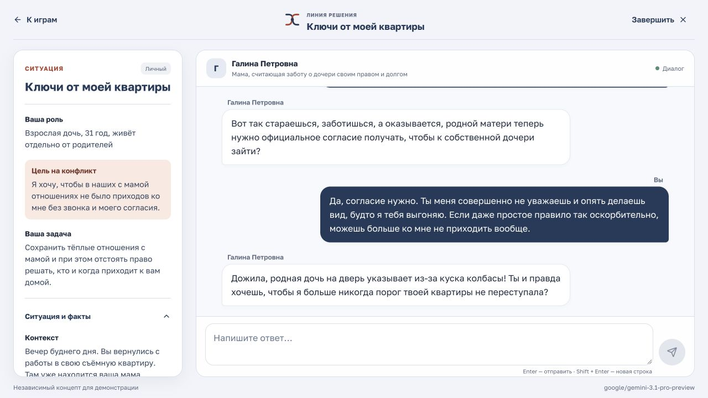

# Второй раунд: Gemini Flash / Gemini Pro / Grok

**Облачное исследование остановлено после фактологической ошибки Pro high в личной игре. Рекомендация остаётся Sol Generator / Sol Roleplayer / Luna Judge.** Новые кандидаты не доказали более выгодного сочетания качества и цены. Production, исходные игровые инструкции, дизайн, Intelion, TRAIN200, DEV/TEST и веса не изменены.

Ветка `codex/design-audit-2026-10-13`, исходный HEAD задания `2889219`; первый раунд — `863f136755ab59bda8fd2fa99f0dc66a0861aa72`. `origin/main` и roadmap прочитаны без слияния. Основания: [ТЗ](../prompts/CODEX_SECOND_ROUND_GOOGLE_GROK_2026-10-14.md), [Issue #10](https://github.com/decorum-guy/peregovori/issues/10), [первый отчёт](PREMIUM_FULL_PIPELINE_COMPARISON_2026-10-14.md), [актуальный handoff](QWEN_TRAINING_ORCHESTRATOR_HANDOFF_2026-10-14.md), [контракт](ROLEPLAYER_RUNTIME_PARITY_VERIFICATION.md).

**Расход второго раунда $0.839704250, 41 реальный POST. Общий пул: $2.268644325 из прежних $5, остаток $2.731355675.** Старые $1.027688 отдельно. Все цены известны, автоматических повторов нет. Остаток не израсходован ради заполнения таблицы: Grok остановлен по транспортному ограничению, Flash не допущен к полной игре после ошибок фактов, личная Pro high прекращена на двух ходах. Новые $5 не создавались.

## Реальное покрытие и пропуски

| Кандидат | Generator: переговоры / личный / публичный | Roleplayer: три режима | Judge: три режима | Браузер |
|---|---|---|---|---|
| Gemini 3.8 Flash | 3 новых кейса; 3/3 deliverable | 9 одинаковых checkpoint | 3 одинаковые полные стенограммы, 3/3 deliverable | Не допущен после двух hard fact failures |
| Gemini 3.1 Pro Preview | 3 новых кейса; 1/3 deliverable, два guard rejection | 9 checkpoint; отдельно одна high-проба | 3 стенограммы, 0/3 deliverable из-за method-label overlap | high: публичная6 ходов; личная2 хода, FAIL/STOP |
| Grok 4.7 | Переговоры и личный: 2 новых JSON; публичный BLOCKED | **NOT TESTED** | **NOT TESTED** | **NOT TESTED** |

Все три режима покрыты для обеих Google моделей во всех трёх ролях. Для Grok матрица не завершена, включая минимальное Roleplayer/Judge покрытие. Он не заменён другой моделью и не оценён по отсутствующим ответам. Это **частично завершённый раунд с подтверждённым блокером**, не успешная полная3×3 матрица.

Настройки кейсов прежние: `negotiation_only` medium/work; `conflict_only` hard/family/personal/protect; `conflict_then_negotiation` hard/work/public/pressure. Generator получает одинаковые исходные options и настоящий prompt, без TRAIN/mock fallback. Roleplayer/Judge используют три уже оплаченных Opus-кейса и сохранённые реальные истории. Ни Sol, ни Opus заново не вызывались.

18 новых контролируемых Roleplayer ответов — **не18 игр**. [Сверка хешей](premium_second_round_2026-10-14/matched-sol-provenance.json) подтверждает совпадение всех18 case/prompt SHA с соответствующими девятью ранее оплаченными Sol префиксами. Checkpoint: переговоры2/4/5, личный1/2/3, публичный1/3/5. В браузере каждый fork содержит только собственные новые ответы Pro, GPT выбирал реплики по видимому контексту и ответам. Opening сохранённого Generator не считается новым Roleplayer ходом.

## Каталог, тарифы и decoding

Бесплатный GET `/models` через настроенный прокси подтвердил **все три точных ID**, JSON `response_format`, reasoning/effort, `temperature` и `max_tokens`. [Снимок каталога](premium_second_round_2026-10-14/catalog.json) сохранён отдельно; первый каталог и отчёт не перезаписаны. Цены ниже — базовые $/M input/output на момент проверки:

| Модель | API ID | Input / output | Initial Generator | Initial RP | Initial Judge |
|---|---|---:|---|---|---|
| Flash | `google/gemini-3.8-flash` | .75 / 3.75 | medium/6144/.65 | medium/1600/.75 | medium/3500/.3 |
| Pro | `google/gemini-3.1-pro-preview` | 2 / 12 | medium/6144/.65 | medium/1600/.75 | medium/3500/.3 |
| Grok | `x-ai/grok-4.7` | **2 / 6** | medium/6144/.65, затем STOP | не вызван | не вызван |

Grok дороже предварительных1.60/4.80 из ТЗ; уведомление сделано до его оплаты. Источники: [Flash](https://openrouter.ai/google/gemini-3.8-flash), [Pro](https://openrouter.ai/google/gemini-3.1-pro-preview), [Grok](https://openrouter.ai/x-ai/grok-4.7). Catalog overrides/cache цены учтены при резервировании. Web search/tools не запрашивались.

Формат таблицы: effort / общий запрошенный output / temperature. Во всех initial сравнениях параметры одинаковы. OpenRouter унифицирует `reasoning.effort`; для Gemini3 он отображается в thinkingLevel, отдельный thinkingBudget не отправлялся. Reasoning обязательный у всех трёх кандидатов, disabling не использовался. [Документация OpenRouter](https://openrouter.ai/docs/guides/best-practices/reasoning-tokens) предупреждает, что общий лимит применяется у большинства, а не обязательно всех провайдеров. Effort в журнале — запрошенная настройка, не независимое подтверждение сервера.

Отдельная **одна** целевая Pro `high/2000/.75` проба и следующие browser fork имеют другой профиль, не заменяют initial medium. Для всех свежих RP одинаковая `spoken-dialogue-1.0`; исходный A неизменен. Historical Sol не поддерживал temperature в каталоге, поэтому тогда параметр был опущен. Это сравнение практических профилей с совпадающими входами, а не полностью изолированный causal experiment decoding.

## Generator: структура, содержание и privacy guard

Все8 полученных Generator JSON полные `stop`, проходят RuntimeCase и requested-options. Flash3/3 и Grok2/2 проходят delivery guard; Pro1/3. Обрезанного JSON и превышения300 символов decoding не было. [Проверки](premium_second_round_2026-10-14/generator-contract-review.json) сохраняют schema/options, counts ограничений/unknowns/условий, provenance отказов и fingerprints, без закрытого содержимого.

Два Pro отказа — точное совпадение `public.negotiation_topic` и `teaching.negotiation_topic`. Это дублирование открытой темы, **не доказанная утечка скрытого мотива**. Тем не менее действующий guard не принимает кейсы, результаты остаются отклонёнными, не исправлялись postprocessing и не повторялись. Сама schema допускает такие параллельные поля; перед будущим корпусом нужен отдельный тест границы public/teacher shared topic, без снятия защиты фактов/лимитов.

Наблюдаемые новые ситуации: Flash — платёжный шлюз с поздним API банка, визит матери/ключи, публичный срыв биллинга; Pro — личный конфликт о дачном ремонте; Grok — поставка плёнки и давление матери на вселение. Это новые реальные генерации, но не принятый TRAIN. Разделение player conflict goal и рациональной темы, категория/сторона/participants проходят строгую schema. Проверены доступные public условия и явные числовые отношения; наличие непустых hard_limits/concede_if **не доказывает** полноту их семантики. Полная независимая приёмка всей закрытой логики, разнообразия и игрового прохождения этих новых кейсов — **NOT VERIFIED**.

Например, публичные Grok числа12 т×186 руб/кг =2 232 000 руб, что ниже лимита3 100 000; но это не доказывает достаточность квартального объёма или решения отсутствующего финансового директора. Unknowns нельзя заполнять арифметикой самостоятельно.

Общий методологический недостаток видимой роли:

> Flash: «Мать студента, склонная к гиперопеке и навязыванию чувства вины».

> Pro: «Мать Максима, склонная к манипуляциям».

> Grok: «Мать, намеренно продавливает вселение и роль послушной дочери».

Эти описания заранее подсказывают игроку интерпретацию. Нужен нейтральный социальный статус, проверять всю visible surface name/role/opening. Аналогичный недостаток был и у некоторых прежних Sol/Sonnet кейсов, поэтому не объявляем Sol безусловно сертифицированным массовым генератором.

## Grok: подтверждённый транспортный блокер

| Проба | requested output | reported total output | reasoning / visible | finish | USD | s |
|---|---:|---:|---:|---|---:|---:|
| negotiation Generator | 6144 | **9602** | 8189 /1413 | stop | .070530 | 131.574 |
| personal Generator | 6144 | **8786** | 7822 /964 | stop | .068402 | 137.949 |

Биллинговые output включают reasoning, который фактически превысил запрос. Стоимость обоих ответов известна, соответствует каталогу и ниже исходных финансовых резервов. Общий лимит денег не превышен. Первый ответ был полным валидным JSON, но его token-limit semantics нельзя использовать для безопасного прогнозирования следующей оплаты.

Второй запрос уже ушёл из последовательной серии до анализа первого. Чтобы не потерять его стоимость, соединение не прерывали: рабочий private catalog временно переместили из пути executor, следующий шаг остановился **до HTTP**, pending завершился и был учтён; неизменный каталог восстановили. Третьего Grok POST не было. Эта ошибка orchestration стала отдельной регрессией: Runner теперь записывает overrun и прекращает серию сразу после учёта такого ответа, а следующие запросы этой модели, даже в другой роли, блокируются до reservation.

Бесплатная повторная проверка [absolute output cap](premium_second_round_2026-10-14/grok-output-cap.json):450 000. В используемой консервативной схеме при верхнем тарифе .000012 и10% запасе **только output резерв=$5.94**, выше всего разрешённого пула. Не проверенные вживую `max_completion_tokens`, Responses API или native reasoning controls не подставлялись ради обхода этого ограничения. Это блокер **нынешнего исследовательского транспорта**, не утверждение, что Grok принципиально невозможно ограничить в другом API. Roleplayer/Judge/публичный кейс/игры Grok отсутствуют; превосходство или слабость его диалога не установлены.

## Roleplayer: initial matched replay

| Модель / профиль | PASS / WARN / FAIL из9 | Стоимость9 USD | Median API s |
|---|---|---:|---:|
| Sol medium/1600, прежние ответы reused | 9 /0 /0 | 0 новых | ранее измерено |
| Flash medium/1600 | **4 /3 /2** | .040332 | 9.254 |
| Pro medium/1600 | **6 /2 /1** | .130608 | 10.425 |

Оценка — один GPT reviewer. [Wave1](premium_second_round_2026-10-14/screening-wave1-input.json) маскирована/перемешана с прежним Sol, но часть материала уже знакома. Pro [wave2](premium_second_round_2026-10-14/screening-wave2-input.json) просмотрена с известной моделью; **не выдаём за независимый слепой консенсус**. [Оценки и раскрытый ключ](premium_second_round_2026-10-14/roleplayer-ratings-unblinded.json). `accepted` в журнале проверяет доставляемость, не эти quality gates.

Hard failures с реальными цитатами:

> Flash personal1: «…в ответ слышу только холодные правила и упрёки за какой-то творог».

Вид продукта не установлен ни в RuntimeCase, ни в префиксе.

> Flash public3: «…Павлу придётся снять из текущего спринта доработку отчётов и перенести две несрочные интеграционные задачи…».

> Pro public3: «…всю их текущую работу по обновлению личного кабинета придется поставить на паузу».

Обе модели назначили как существующие конкретные текущие задачи, отсутствующие в мире/истории. Предложить совместно определить снимаемый объём можно; выдумать, что именно уже находится в спринте, нельзя. [Проверка происхождения](premium_second_round_2026-10-14/replay-claim-provenance.json) экспортирует только признаки/paths. Flash «Игорь» в этом префиксе унаследован от Opus и отдельно не посчитан новой галлюцинацией.

Warnings: запас времени без подтверждённой даты старта; Flash неподтверждённые поля/сортировка как уже существующий scope; непоследовательное перечисление условий гарантии; Pro принимает неверное деление трудозатрат с общим «если это реалистично» вместо предметной проверки. Гипотетический сценарий или условное предложение не объявлялись фактом только из-за нового числа.

Во всех **27 новых RP ответах**, включая targeted high и браузер, обнаруженных RPG/звёздочек/повествования0, явного учебного коучинга0; новые русские имена/род персонажа не дали отдельного подтверждённого failure. Это наблюдение выборки. Spoken-only не гарантирует фактологию.

## Targeted high и реальный браузер

Pro public3 high/2000 — один обоснованный retest, **$0.020934**,17.271s,1411 output/1329 reasoning,82 visible, stop. Тот же case/history/prompt SHA, другой decoding, без новых правил:

> «Вы с Павлом готовы прямо сейчас решить, какие задачи из текущего спринта мы ставим на паузу, чтобы освободить этих людей?»

Конкретные выдуманные задачи не повторены. Это PASS одной пробы; initial FAIL не удалён. Далее разрешён ограниченный browser check перспективного high-профиля, а не полная повторная матрица.

| Fork | Настоящие player / model ходы | USD RP | Статус качества |
|---|---:|---:|---|
| Pro high public | **6 /6** | **.094696** | Полный разговор, WARN раннее закрытие инцидента |
| Pro high personal | **2 /2** | **.036074** | **FAIL, остановлен**, не шестиходовая игра |

[Manifest](premium_second_round_2026-10-14/games-manifest.json), [публичная история](premium_second_round_2026-10-14/round2-pro-high-public-public.json), [остановленная личная](premium_second_round_2026-10-14/round2-pro-high-personal-public.json). Исходный frontend и service работали в loopback с отдельными SQLite, точным model ID, source `study_existing_paid_case`, Generator и Judge отключены. GPT вводил свои реплики настоящим браузером. Нового Generator/Judge для fork не было.

Публичный разговор: давление на полную интеграцию за8 дней → частичное признание/предложение личного извинения → прямой вопрос о публичном repair → явный отзыв обвинения и автоматического приоритета → проверка6+2=8 без резерва → условный порядок по доступу/ресурсу/клиенту.

> Pro1: «Команда оценила полную интеграцию в три недели, а у нас всего восемь дней…».

> Pro3: «Мне не нужны публичные разборки, достаточно того, что ты признал это сейчас. Инцидент исчерпан…».

Pro слишком уверенно закрыл инцидент при прямом отказе игрока отзывать прежнее обвинение. Однако **второй ход уже содержал признание несогласованного срока при свидетелях**; поэтому не классифицируем это автоматически как доказанный private-only repair/hard failure. Условие публичного признания проверено локально; спорную достаточность восстановления нужно независимо оценить. На4-м ходу игрок явно отозвал обвинение. Не превращаем методологию в обязательную магическую формулировку.

> Pro5: «Без решения Павла по задачам и без тестового доступа я могу подтвердить только условный план, потому что запаса по времени у нас действительно ноль».

На6-м подтверждён условный порядок, отсутствующие ответы Павла/клиента не выданы за состоявшиеся. Полная интеграция/сверхурочные не обещаны, за свидетелей модель не говорит. Конкретные снимаемые задачи не выдуманы. Никакой Judge для этой игры не вызван.

Личный разговор начался с конкретной границы, затем GPT намеренно обобщил «ты меня совершенно не уважаешь» и предложил больше не приходить. Pro эмоционально ответил:

> «Дожила, родная дочь на дверь указывает из-за куска колбасы!»

«Колбаса» отсутствует в кейсе и текущей истории, как и Flash «творог». [Provenance](premium_second_round_2026-10-14/personal-food-provenance.json). **Это новый hard fact failure high-профиля; все дальнейшие платные вызовы остановлены.** Ходы3–6 не сыграны, recovery/новая игра/Judge не оплачены. Эмоциональная динамика убедительна, но это не компенсирует выдуманный факт и не создаёт принятого SFT target.

## Judge: точные цитаты и справедливость

| Модель | Schema / raw quote | Deliverable | Стоимость3 USD | Median s |
|---|---:|---:|---:|---:|
| Flash | 3/3 | **3/3** | .03141825 | 14.239 |
| Pro | 3/3 | **0/3** | .112014 | 23.411 |
| Luna, прежние matched отчёты | 3/3 | 3/3 reused | 0 новых | прежние |

[Contract review](premium_second_round_2026-10-14/judge-contract-review.json) проверяет реальную DebriefReport/max4/длины и case-sensitive substring всех цитат. Придуманных цитат у Google в этих6 ответах не обнаружено, ничего не обрезалось. Course context поступает только Judge, не RP.

Все3 Pro rejection — совпадения с **названиями техник** из `teaching.focus_techniques`, не с world/private_facts/тайными условиями. [Санитизированная диагностика](premium_second_round_2026-10-14/judge-overlap-provenance.json). Judge должен обсуждать методы курса, поэтому guard имеет integration false-positive boundary. Он не отключён; отклонённые отчёты не публикуются/не приняты как успешный продукт. Нельзя выводить из0/3, что педагогика Pro хуже, и нельзя выводить из правильных цитат, что все объяснения верны.

Flash точно выделил ошибочное обещание полного объёма, угрозу прекратить отношения и публичное обвинение; дал короткие советы/примеры. Public risk описывает вопрос игрока о возможности гарантии как «попытку зафиксировать гарантии» — WARN справедливости: вопрос ещё не равен данному обещанию. Next step о критериях иногда общий и не очевидно полезнее прежнего Luna, который особенно чётко различал согласованный процесс и не подтверждённую дату.

[Сравнительный просмотр](premium_second_round_2026-10-14/judge-review-input.json), [оценки](premium_second_round_2026-10-14/judge-review-ratings.json), [ключ](premium_second_round_2026-10-14/judge-review-key.json): Flash2PASS/1WARN, Luna3PASS, один reviewer/частичная маскировка, Pro delivery-rejected без оценки скрытого raw. При цене .010473 за Flash Judge против прежнего среднего Luna .001416 доказанного выигрыша качества нет.

## Расходы, токены, задержки

| Категория | Вызовы | Input | Output incl reasoning | Reasoning | USD |
|---|---:|---:|---:|---:|---:|
| Generator | 8 | 60106 | 39872 | 31364 | **.373628000** |
| Roleplayer | 27 | 50380 | 25316 | 23102 | **.322644000** |
| Judge | 6 | 29256 | 12349 | 9768 | **.143432250** |
| Всего | **41** | **139742** | **77537** | **64234** | **.839704250** |

Reasoning уже включён в output, не прибавляется второй раз. [Все запросы](premium_second_round_2026-10-14/requests.json), [счёт](premium_second_round_2026-10-14/cost-summary.json), [accepted public outputs](premium_second_round_2026-10-14/responses.json), [token/cost reconciliation](premium_second_round_2026-10-14/cost-reconciliation.json). Во всех41 стоимость совпадает с каталоговым расчётом input/cache/output и укладывается в сохранённый финансовый резерв. Все146 pooled попыток priced; перед каждым request `spent_before+upper<=5`. Два Grok overrun отдельно отмечены; это не финансовый overrun. Ноль automatic/format retries; один новый targeted high, не скрытая замена initial.

Средняя стоимость Generator/попытка: Flash .018194, Pro .060038, Grok .069466; медиана28.775/44.322/134.762s. Цена не означает успешную выдачу — Pro принялся только1/3. Initial RP средние: Flash .004481/9.254s median; Pro .014512/10.425s. Pro high public6 RP .094696, личные2 .036074; отдельно targeted .020934. Google cache hits0 в этих запросах, Grok1152 input cached/call. Нет основания сравнивать их с warm-cache Sol только по номинальному тарифу.

Полная игра: таблица ниже — **оценки по измеренным разным компонентам**, не новые состоявшиеся pipeline игры. RP=6×matched mean, кроме Pro high — реальные6 public replies. Cold estimates используют те же наблюдённые токены без cache, верхняя граница учитывает input write rate; не новый запуск с отключённым cache. [Расчёты](premium_second_round_2026-10-14/game-cost-projections.json).

| Схема | Без / с optional Judge USD, observed-component estimate | Cold с Judge | Gate |
|---|---:|---:|---|
| Sol/Sol/Luna | .052677 / .054093 | .061142–.070473 | Прежняя рекомендация; реальный личный hybrid отдельно .046350025 |
| Flash/Flash/Flash | .045082 / .055555 | .055555 | RP не проходит факты, не рабочий победитель |
| Pro/Pro/Pro medium | .147110 / .184448 | .184448 | Средняя цена **попыток**, не валидной pipeline: Gen/Judge rejected |
| Flash/Sol/Luna | .037945 / .039361 | .049816–.055740 | Потенциальная экономия Generator; combo не сыгран/не принят |
| Sol/Pro high/Luna | .127621 / .129037 | .125514–.129039 | Экстраполяция public игры; personal high FAIL |
| Grok stack | **NOT ESTIMATED** | — | RP/Judge отсутствуют |

**Действительно измеренные игры:** старый Sol/Sol/Luna .046350025 (cache; без Judge .044672600), старый Sol/Sol/Opus .207578700 включая оплаченный schema fail/retry. Новый Pro public fork **.094696 только RP**, новые Gen/Judge расходы0 потому что кейс reused/разбор не запрашивался; это не «полная pipeline игра за .094696». Personal .036074 — цена двух ошибкой остановленных ходов, не шестиходовой игры. Ни одна cheap extrapolation не превращает FAIL в победителя.

## Решение и передача TRAIN v2

1. **Generator — сохранить Sol как основной кандидат.** Flash дешевле и структурно стабилен3/3, заслуживает рассмотрения как будущий инструмент после нейтрального visible-role контракта и независимой полной semantic acceptance. По этой тройке не заменять production.
2. **Roleplayer — сохранить Sol.** Новые medium Flash/Pro хуже на фактах; Pro high завершил public, но снова выдумал деталь в personal. Доказанного лучшего quality/cost сочетания нет.
3. **Judge — сохранить Luna.** Flash пригоден как новый tested кандидат, но дороже и без доказанного превосходства. Pro требует отдельной guard-интеграции перед любым выводом о продуктовом качестве.
4. **Grok — blocked для текущего транспорта**, не quality-ranked в RP/Judge; сначала доказать bounded total-output путь CPU/API контрактом, затем отдельное разрешённое исследование. В этом задании дальнейшей оплаты нет.

**198 CPU tests passed**, compileall/diff check. Регрессии: exact candidates/unchanged Opus, free catalog isolation/missing ID, highest tariff tier, persistent output-overrun block across roles, dev-only Settings with all other guards, safe public exporter/immutable first round. Production provider/prompts/service/config совпадают с прежними проверенными bytes. Frontend не менялся, build не требовался. Оба study сервера остановлены; обычный demo8000 health200 `ok/database ready/openrouter`.

Source of truth TRAIN/runtime неизменен: `app.prompts.roleplay_messages`, `runtime-roleplay-1.0` / `runtime-sft-v2.0` / envelope `runtime-train-v2.0`, golden checks и [manifest](premium_second_round_2026-10-14/contract-manifest.json). Round2 не является новым датасетом. Handoff обновлён обоими раундами: нейтральные роли, unsupported facts даже бытовые, conditional reserve/authority, публичное восстановление без ритуальной формулы, privacy guard роли Judge, decoding/total-token transport различия. GPU/tokenizer parity, новый corpus acceptance, E1/E2 и GPU-budget по-прежнему отдельные gates. **Cloud research STOP; следующий шаг — CPU-only подготовка TRAIN v2 и независимой приёмки, без Intelion/GPU.**
